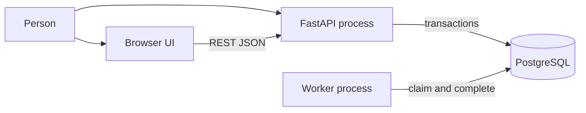
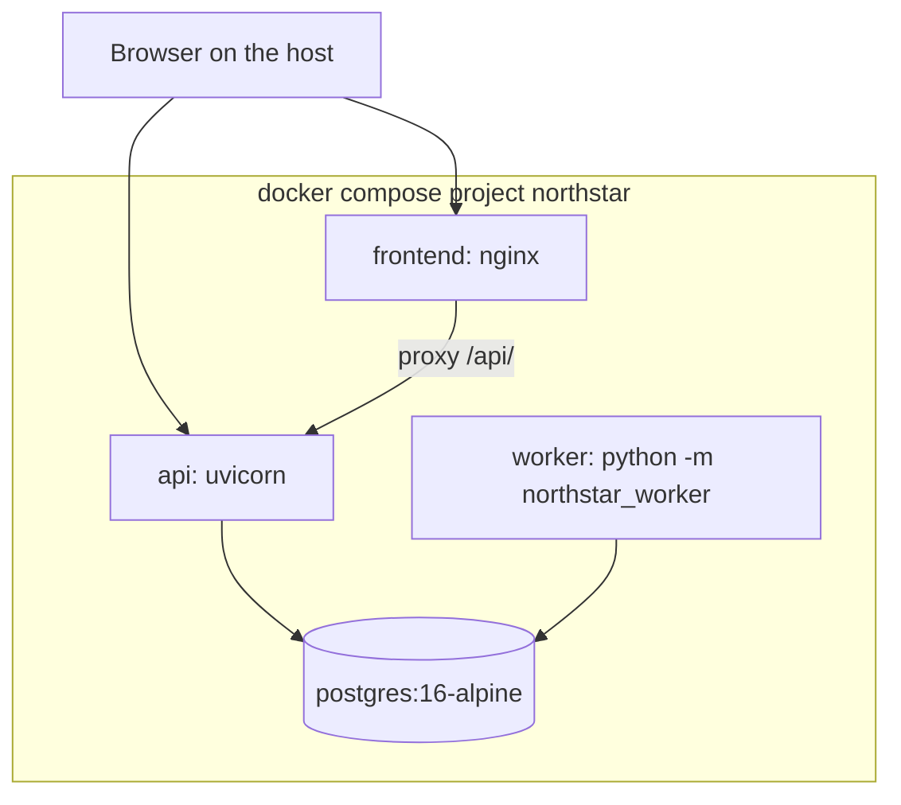

# Architecture

## Context

A person submits work either to the React application or directly to the API. Both paths end in the same validation and the same `jobs` row. The worker never receives the job over HTTP. It reads the queue from PostgreSQL, which is the only coordination point.

## Containers

Local development can replace the frontend container with Vite on port 5173. Vite strips the `/api` prefix and forwards to `127.0.0.1:8000`.

## Modules

`backend/src/northstar` is the shared library.

| Module | Responsibility |
| --- | --- |
| `api` | HTTP routes, error shape, body-size middleware, CORS |
| `domain` | Status enums, input models, safe error text |
| `algorithms` | Merge sort, Dijkstra, word frequency, Fibonacci |
| `services.jobs` | Create, list, get, cancel, idempotency |
| `services.queue` | Claim, execute, finish, recover leases |
| `migrate` | Apply SQL files under advisory lock `4993` |
| `models` | SQLAlchemy mappings. SQL files remain the schema source of truth |

`worker/src/northstar_worker` owns the process lifecycle: signals, the poll loop, and the heartbeat file. It calls `prepare_for_serve` and then `run_until_stopped`.

## Request path

1. The client posts JSON. Middleware rejects a `Content-Length` above the configured maximum.
2. Pydantic rejects unknown fields, unknown job types, and values outside the limits.
3. `create_job` canonicalizes the payload, optionally checks the idempotency fingerprint, inserts the job in `queued`, and writes a `job_events` row with reason `accepted`.
4. The response includes the id, status, attempts, and the stored input. It does not include the idempotency key or the worker id. Attempt rows include the worker id after a claim.

## Execution path

1. The worker recovers expired leases, then claims one job.
2. The claim transaction selects the oldest `queued` or `retrying` row with `FOR UPDATE SKIP LOCKED`, sets `running`, increments `version`, sets `worker_id` and `lease_expires_at`, and inserts `job_attempts` plus a `claimed` event.
3. The transaction commits before the algorithm runs, so the row lock is not held during CPU work.
4. `run_job` validates the stored payload again and dispatches to the algorithm package.
5. Completion updates the job only when `status` is still `running`, `version` matches, and `worker_id` matches. That fence stops a stale worker from writing after lease recovery.

## Startup

`prepare_for_serve` waits up to `NORTHSTAR_DATABASE_WAIT_SECONDS` for `SELECT 1`. If the wait is cancelled by shutdown, the process returns. If the database never answers, it raises `RuntimeError` with the text `database is not ready` and does not include the URL. It then applies pending migrations.

There is no separate one-shot migrate container. A one-shot container would block `docker compose up --wait`. `python -m northstar.migrate` remains available for an explicit run.

## Observability

Logs are single-line JSON. Fields that start with `ns_` are copied into the record. Payloads are not logged. Unexpected exceptions log the exception type only, because a chained validation error can contain the submitted input.

State changes are also rows in `job_events`. Reasons include `accepted`, `claimed`, `completed`, `cancelled`, `retryable_failure`, `permanent_failure`, `retries_exhausted`, `lease_expired`, and `ownership_lost`.

The worker rewrites `/tmp/northstar-worker-heartbeat` each loop. The container health check treats a heartbeat older than 30 seconds as unhealthy.

## Configuration

Settings use the `NORTHSTAR_` prefix. See `.env.example`. Constructor arguments override environment variables, which is how tests pin a short lease and a small body limit without editing the process environment permanently.
